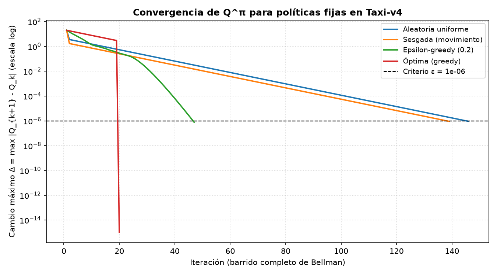
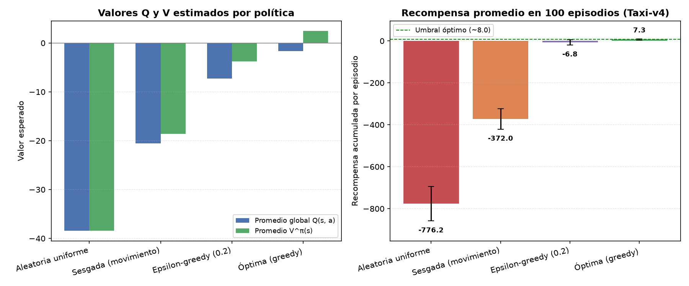
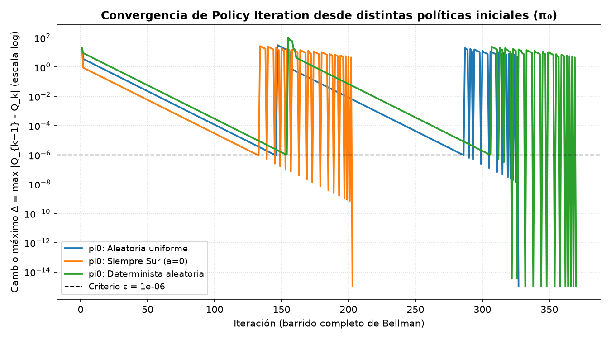
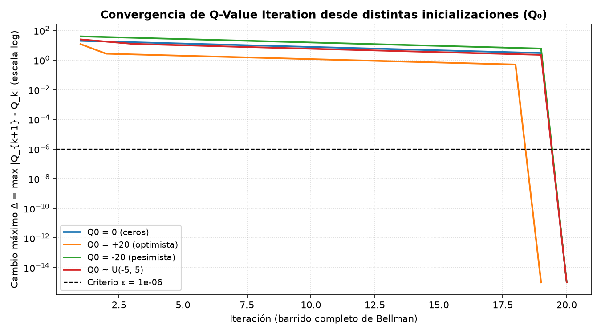

# Reporte: Iteración de Políticas y Valor para la Función $Q(s,a)$ en `Taxi-v4`

## 1. Descripción de la Implementación

### 1.1 Entorno: `Taxi-v4` (Gymnasium)

- **Espacio de estados ($\mathcal{S}$):** $500$ estados discretos (`Discrete(500)`), que codifican la posición del taxi en la cuadrícula $5\times 5$, la ubicación del pasajero ($5$ posibles: $4$ paradas + en el taxi) y el destino ($4$ posibles).
- **Espacio de acciones ($\mathcal{A}$):** $6$ acciones discretas (`Discrete(6)`): `0` (Sur), `1` (Norte), `2` (Este), `3` (Oeste), `4` (*Pickup*) y `5` (*Dropoff*).
- **Estructura de recompensas:**
  - $-1$ por cada paso normal de movimiento.
  - $+20$ al entregar exitosamente al pasajero en su destino (`terminated = True`).
  - $-10$ al ejecutar *Pickup* o *Dropoff* de manera ilegal.
- **Horizonte:** Máximo $200$ pasos por episodio (`truncated = True`), factor de descuento $\gamma = 0.9$.

### 1.2 Algoritmos Implementados en `value.py`
La implementación utiliza matrices `numpy` de dimensión $(500, 6)$ para $Q(s,a)$ y $\pi(a|s)$, leyendo las transiciones exactas $P(s'|s,a)$ mediante la API de Gymnasium (`env.unwrapped.P`) para los barridos de Bellman y evaluando las políticas resultantes mediante interacción episódica estándar (`env.reset()` y `env.step()`):

1. **Evaluación Iterativa de Políticas para $Q^\pi(s,a)$ (`evaluate_policy_q`):**
   Dada una política fija $\pi(a|s)$, se aplica de forma síncrona la ecuación de expectativa de Bellman:
   $$Q_{k+1}^\pi(s, a) = \sum_{s'} P(s'|s,a) \left[ r(s,a,s') + \gamma (1 - \text{done}) \sum_{a'} \pi(a'|s') Q_k^\pi(s', a') \right]$$
2. **Iteración de Políticas (`policy_iteration`):**
   Alterna evaluación completa de $Q^\pi$ y mejora *greedy* $\pi'(s) = \arg\max_a Q^\pi(s,a)$ hasta que la política es estable ($\pi' = \pi$).
3. **Iteración del Valor para $Q$ (`q_value_iteration`):**
   Aplica directamente el operador de optimalidad de Bellman:
   $$Q_{k+1}(s, a) = \sum_{s'} P(s'|s,a) \left[ r(s,a,s') + \gamma (1 - \text{done}) \max_{a'} Q_k(s', a') \right]$$
4. **Criterio de Convergencia:**
   En todos los algoritmos se detiene el proceso iterativo cuando el cambio máximo entre iteraciones consecutivas cumple:
   $$\Delta_k = \max_{s \in \mathcal{S},\, a \in \mathcal{A}} \left| Q_{k+1}(s,a) - Q_k(s,a) \right| < \epsilon, \quad \epsilon = 10^{-6}$$

---

## 2. Resultados y Gráficos

Todos los experimentos se ejecutaron con $\gamma = 0.9$, $\epsilon = 10^{-6}$ y evaluación de $100$ episodios por política (`seed = 42`).

### 2.1 Evaluación de $Q^\pi(s,a)$ para diferentes políticas fijas

| Política fija ($\pi$) | Iteraciones | $Q_{\text{prom}}$ | $Q_{\text{mín}}$ | $Q_{\text{máx}}$ | $V^\pi_{\text{prom}}$ | Recompensa media ($\pm\sigma$) | Pasos medios | Tasa de éxito | $\|Q^\pi - Q^*\|_\infty$ |
| :--- | :---: | :---: | :---: | :---: | :---: | :---: | :---: | :---: | :---: |
| Aleatoria uniforme ($\frac{1}{6}$) | 146 | -38.451 | -45.994 | 20.000 | -38.451 | -776.18 ($\pm$82.21) | 197.93 | 3.0% | 45.345 |
| Sesgada (movimiento) | 139 | -20.567 | -27.096 | 20.000 | -18.568 | -371.97 ($\pm$48.84) | 198.21 | 1.0% | 30.670 |
| $\epsilon$-greedy ($\epsilon=0.2$) | 47 | -7.284 | -20.837 | 20.000 | -3.767 | -6.84 ($\pm$12.45) | 17.85 | 100.0% | 6.561 |
| Óptima (*greedy*) | 20 | -1.675 | -14.497 | 20.000 | 2.468 | 7.34 ($\pm$2.64) | 13.66 | 100.0% | 0.000 |

### 2.2 Policy Iteration desde distintas políticas iniciales ($\pi_0$)

| Política inicial ($\pi_0$) | Mejoras externas | Barridos totales | $Q_{\text{prom}}$ | Recompensa media | Tasa de éxito | $\|Q - Q^*\|_\infty$ |
| :--- | :---: | :---: | :---: | :---: | :---: | :---: |
| $\pi_0$: Aleatoria uniforme | 13 | 327 | -1.675 | 7.34 | 100.0% | 0.00e+00 |
| $\pi_0$: Siempre Sur ($a=0$) | 17 | 203 | -1.675 | 7.34 | 100.0% | 0.00e+00 |
| $\pi_0$: Determinista aleatoria | 17 | 370 | -1.675 | 7.34 | 100.0% | 0.00e+00 |

### 2.3 Q-Value Iteration desde distintas inicializaciones ($Q_0$)

| Inicialización ($Q_0$) | Iteraciones | $\Delta_{\text{final}}$ | $Q_{\text{prom}}$ | Recompensa media | Tasa de éxito | $\|Q - Q^*\|_\infty$ |
| :--- | :---: | :---: | :---: | :---: | :---: | :---: |
| $Q_0 = 0$ (ceros) | 20 | 0.0 | -1.675 | 7.34 | 100.0% | 0.00e+00 |
| $Q_0 = +20$ (optimista) | 19 | 0.0 | -1.675 | 7.34 | 100.0% | 0.00e+00 |
| $Q_0 = -20$ (pesimista) | 20 | 0.0 | -1.675 | 7.34 | 100.0% | 0.00e+00 |
| $Q_0 \sim \mathcal{U}(-5, 5)$ | 20 | 0.0 | -1.675 | 7.34 | 100.0% | 0.00e+00 |

---

## 3. Análisis y Conclusiones

1. **Impacto de la política sobre $Q^\pi(s,a)$ y velocidad de convergencia:**
   - La **política aleatoria uniforme** ejecuta *Pickup* y *Dropoff* ilegales con probabilidad $2/6 \approx 33.3\%$ en cada paso, acumulando penalizaciones de $-10$ que hunden $Q_{\text{prom}}$ a $-38.451$ y la recompensa episódica a $-776.18$ (solo $3.0\%$ de entregas antes del límite de $200$ pasos). Además, requiere $146$ iteraciones para converger porque los episodios largos propagan el descuento $\gamma^k$ a lo largo de muchos ciclos sin alcanzar estados terminales.
   - La **política sesgada hacia movimiento** reduce las acciones ilegales al $10\%$, mejorando notablemente $Q_{\text{prom}}$ a $-20.567$ y la recompensa media a $-371.97$, aunque sigue sin dirigir al taxi hacia el pasajero ni al destino ($1.0\%$ de éxito).
   - La política **$\epsilon$-greedy ($\epsilon=0.2$)** sobre la política óptima logra $100\%$ de entregas exitosas en $17.85$ pasos promedio y converge en solo $47$ iteraciones, pero la probabilidad residual de acciones aleatorias (especialmente *Pickup*/*Dropoff* ilegales con probabilidad $0.2/6$) reduce la recompensa promedio a $-6.84$.
   - La **política óptima** alcanza $100\%$ de éxito en $13.66$ pasos promedio con recompensa media de $7.34$ ($\pm 2.64$) y converge de forma exacta ($\Delta = 0.0$) en apenas $20$ iteraciones, correspondiente a la longitud máxima de camino óptimo en el grafo de `Taxi-v4`.

2. **Independencia respecto a la política inicial ($\pi_0$) e inicialización ($Q_0$):**
   - En *Policy Iteration*, las tres políticas iniciales (`uniforme`, `siempre Sur` y `determinista aleatoria`) convergen exactamente al mismo punto fijo $Q^*$ ($\|Q - Q^*\|_\infty = 0.0$). La trayectoria cambia en el número de mejoras externas ($13$ para $\pi_0$ uniforme frente a $17$ para las deterministas) y barridos totales ($203$–$370$), observándose en la gráfica los picos característicos de $\Delta_k$ cada vez que se actualiza la política $\pi$ y se reinicia su evaluación.
   - En *Q-Value Iteration*, todas las inicializaciones ($0$, $+20$, $-20$ y aleatoria) convergen en $19$–$20$ iteraciones al mismo $Q^*$, confirmando la propiedad de contracción del operador de optimalidad de Bellman con factor $\gamma = 0.9$.

3. **Comparación entre Policy Iteration y Q-Value Iteration:**
   - *Policy Iteration* realiza menos pasos de mejora externa ($13$–$17$), pero al evaluar completamente $Q^\pi$ hasta $\Delta < 10^{-6}$ en cada fase acumula entre $203$ y $370$ barridos de Bellman.
   - *Q-Value Iteration* combina mejora y respaldo en cada barrido, convergiendo en solo $19$–$20$ barridos totales al óptimo exacto para este MDP determinista de horizonte corto.

---

